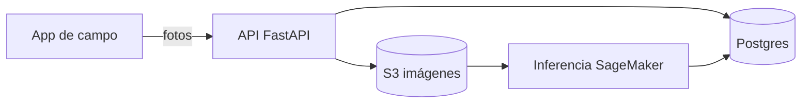

# Documentación Python

Documenta el **por qué** y el **contrato**, no lo que el código ya dice. Un docstring que repite el nombre de la función es ruido.

## Idioma

Sigue el del repo: mira README, docstrings y commits existentes. Si el repo es nuevo y lo leerá solo el equipo local, español; si es librería compartida o el equipo es internacional, inglés. Nunca mezcles idiomas dentro del mismo archivo.

## Docstrings (Google)

Obligatorios en funciones, clases y métodos **públicos** de `domain`, `application` y librerías compartidas. Opcionales en privados obvios y en pruebas.

```python
def asignar_cuadrillas(lotes: list[Lote], cuadrillas: list[Cuadrilla]) -> Plan:
    """Asigna cuadrillas a lotes maximizando toneladas cosechadas por día.

    Respeta la capacidad diaria de cada cuadrilla y no asigna lotes en cuarentena.

    Args:
        lotes: Lotes listos para cosecha; deben tener `toneladas_estimadas`.
        cuadrillas: Cuadrillas disponibles hoy.

    Returns:
        Plan con una asignación por cuadrilla; lotes sin asignar en `plan.pendientes`.

    Raises:
        SinCuadrillas: Si `cuadrillas` está vacía.
    """
```

- Primera línea: qué hace, en imperativo o descriptivo, ≤ 1 línea.
- Documenta unidades (toneladas, metros, UTC), rangos válidos y efectos secundarios.
- No repitas los tipos que ya están en la firma.
- ruff lo hace cumplir con `select = ["D"]` y `convention = "google"`.

## Comentarios

Solo para lo que el código no puede decir: una restricción externa, un bug de una librería, por qué se eligió un algoritmo. Nada de `# incrementa el contador`. Borra código comentado (ruff `ERA`).

## ADR (Architecture Decision Records)

Escribe un ADR cuando la decisión es difícil de revertir o alguien preguntará "¿por qué así?" en seis meses: nueva dependencia de infraestructura, cambio de capas, elección de base de datos, de modelo de ML, de orquestador, formato de datos.

- Ubicación: `docs/adr/NNNN-titulo-en-kebab.md`, numeración correlativa.
- Plantilla: `references/adr-madr.md` (MADR 4, versión corta).
- Estados: `propuesto` → `aceptado` → (`reemplazado por NNNN` | `deprecado`). Nunca edites un ADR aceptado para cambiar la decisión: escribe uno nuevo que lo reemplace.

## README de servicio

Secciones mínimas, en este orden:
1. Qué hace (2-3 líneas) y quién lo usa.
2. Cómo correrlo en local (comandos copiables: `uv sync`, variables, `uv run ...`).
3. Cómo probarlo (`uv run pytest`, skill `verify`).
4. Cómo se despliega (CI, ambientes) y dónde ver logs y métricas.
5. Arquitectura en un diagrama + enlace a ADRs.
6. Dueños y contacto.

## Diagramas

Mermaid dentro del markdown (GitHub lo renderiza). Nivel C4 que corresponda:
- **Contexto**: el sistema, sus usuarios y sistemas externos.
- **Contenedores**: API, workers, bases de datos, colas, buckets.
- Rara vez más detalle: el código es el diagrama de componentes.



## Sitio de documentación

Para docs nuevas: Zensical (sucesor de Material for MkDocs, que queda en mantenimiento hasta 2027-05). Si el repo ya usa MkDocs Material, no migres sin un motivo.

## Verificación

1. `ruff check --select D` pasa en el código tocado.
2. El README tiene las 6 secciones y sus comandos funcionan copiados tal cual.
3. Cada decisión difícil de revertir del cambio tiene ADR.
4. Los diagramas Mermaid renderizan (vista previa de GitHub).
